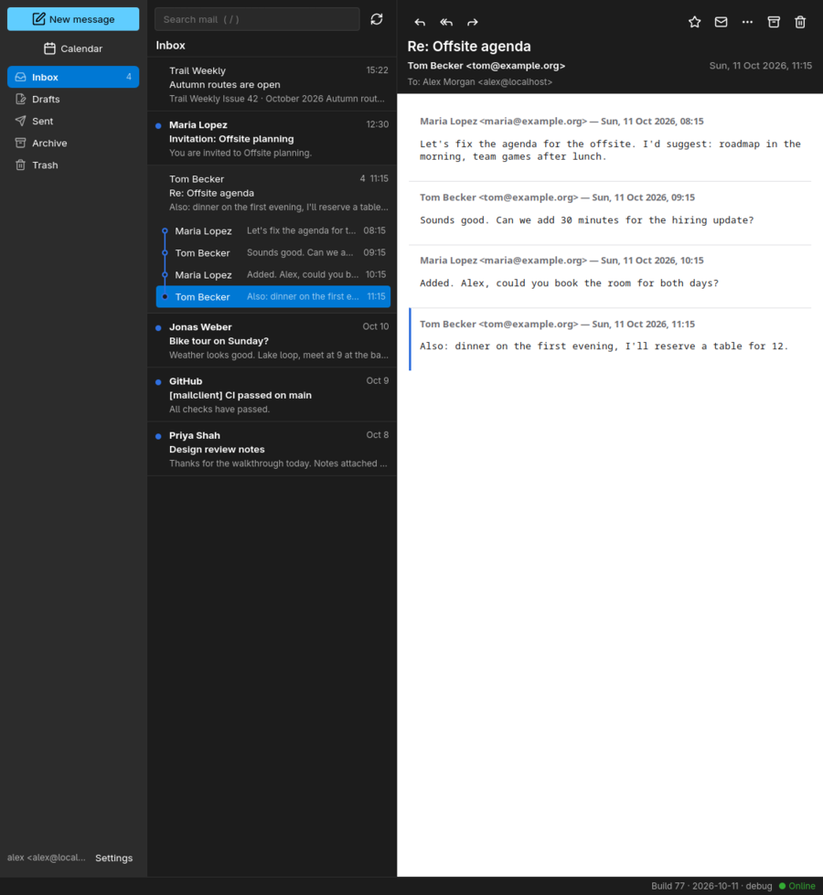
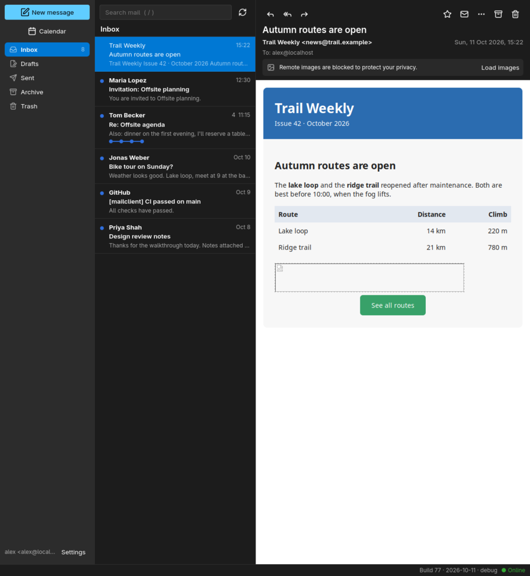
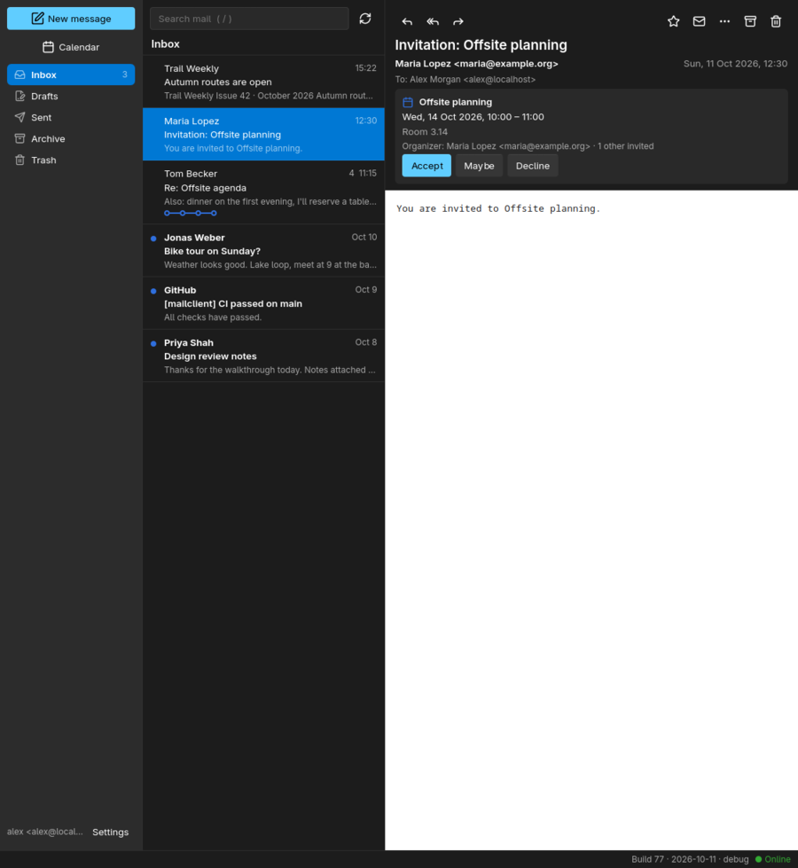
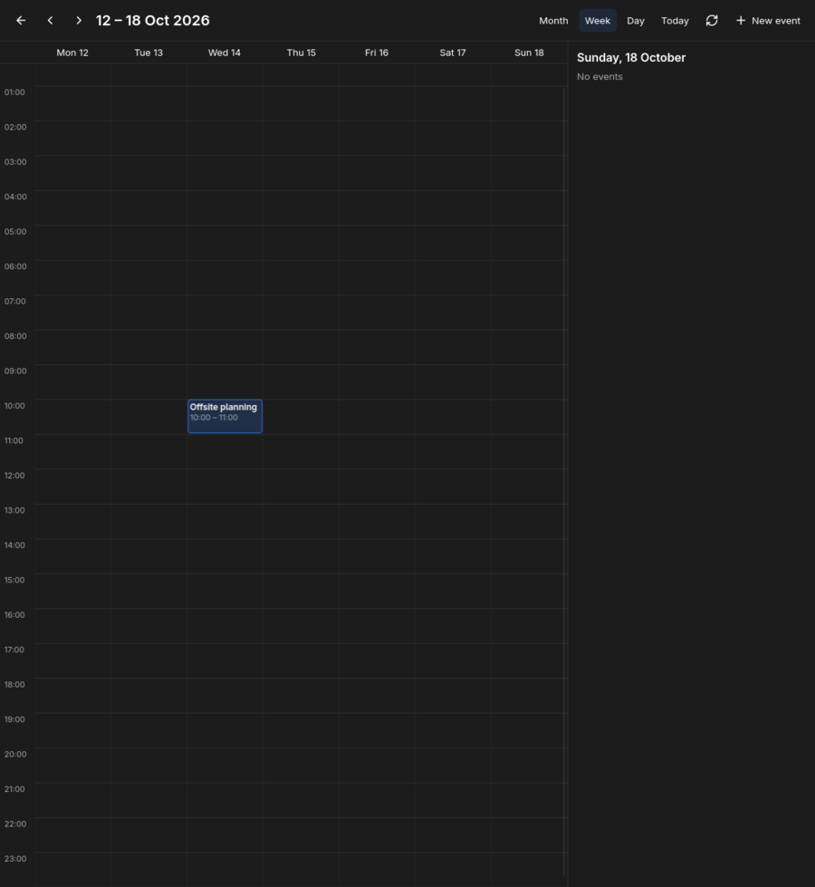
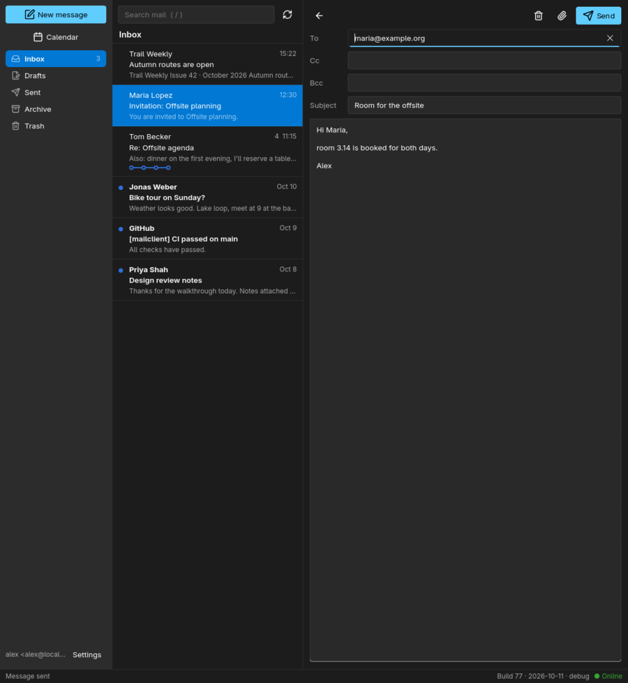
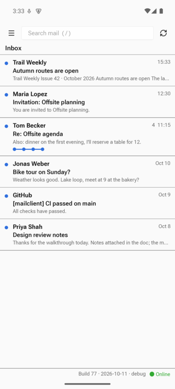
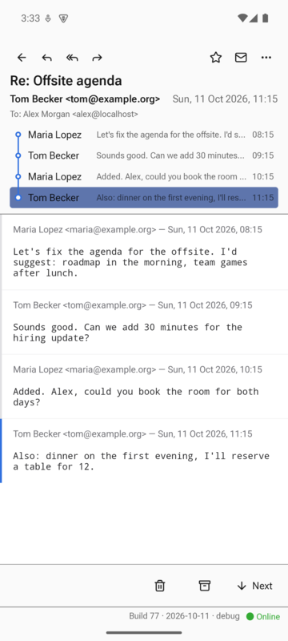
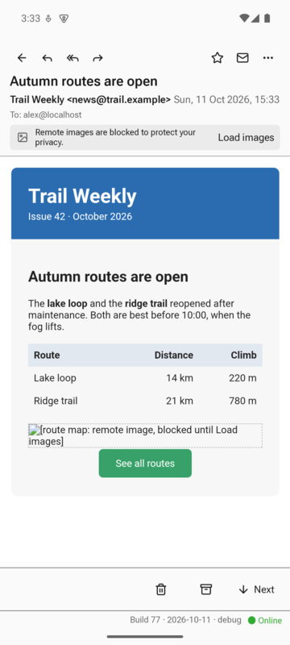
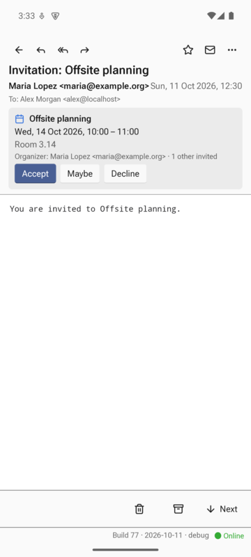
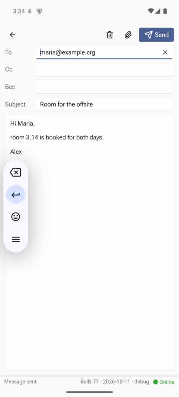

# mailclient

[](https://github.com/dschoerk/mailclient/actions/workflows/ci.yml)

A desktop email client in Rust with a [Slint](https://slint.dev) UI. HTML mail is
rendered by an embedded [Servo](https://servo.org) engine with scripting disabled.

Status: **v0.1**: one IMAP/SMTP account, Linux desktop; Android in progress.

## Screenshots

**Conversations.** One row per conversation; the open one unfolds into a timeline, and the
reader shows all its messages one below the other.



**HTML mail, safely.** Newsletters render in an embedded engine with scripts off; remote
images stay blocked until you click "Load images".



**Invitations and calendar.** Invitations from Gmail, Outlook and others show a card with
Accept / Maybe / Decline; the answer is mailed to the organizer and the event lands in the calendar.

| Invitation | Calendar (week view) |
|---|---|
|  |  |

**Compose** plain-text mail with attachments; drafts are saved when you close the window.



**Android.** The same app on phones: folders in a drawer, swipe to archive or delete,
HTML in the system WebView under the same rules.

| Inbox | Conversation | HTML mail | Invitation | Compose |
|---|---|---|---|---|
|  |  |  |  |  |

The screenshots show made-up mail on the local GreenMail test server (see "End-to-end tests").

## Features

- Account setup with server guesses for common providers; login verified before saving.
  Password stored in the system keyring (Secret Service).
- Multiple accounts (Settings: add, edit, sign in again, remove), each with its own sync engine and cache,
  and an "All inboxes" view; a colored bar and the account's address in the message list mark each
  account. Each account's color can be picked in Settings.
- Conversations: the list shows one row per conversation (by `References`/`In-Reply-To`; on Gmail
  by Gmail's own conversations, `X-GM-THRID`),
  the open one unfolds into a timeline of its messages, and the reader shows them all
  one below the other, including your replies from Sent.
- Folder list with special-use detection, unread counts.
- Local SQLite cache: the last 500 messages per synced folder; bodies downloaded on
  open plus the 40 newest per sync (not in Gmail's All Mail, which repeats the other folders; in
  Android's background check only the new mail's). Works offline from the cache.
- Sync asks for changes only where the server can tell: CONDSTORE servers (Gmail, Fastmail,
  Dovecot, iCloud) send the flags changed since the last sync, and CalDAV servers a change tag that
  spares re-reading an unchanged calendar. Others (Exchange, GMX, Yahoo) get the flags of the
  whole window each time a folder changes.
- Push via IMAP IDLE on the inbox, polling every 5 minutes as a fallback; a system
  notification for new unread mail while the app runs (Linux desktop and Android). On Android
  a background job checks the inboxes about every 15 minutes while the app is closed.
- Read, flag, mark read/unread, archive, delete, also for several conversations at once
  (tick them at the row's left edge, by long press on phones, or with `x`). On phones a row swiped
  right is archived, swiped left deleted (a quick flick is enough); dragged past a third of the way
  and held, it turns blue and offers the folders to move it to. Changes apply instantly and are
  queued for the server, so they also work offline; a banner says when an account cannot reach its
  server, why, and how many changes wait for it. The row's place shows what happened for
  5 seconds, with Undo (or `z`) and Find similar (the sender's mail in this folder); only then is
  the change sent.
- Full-text search (SQLite FTS5) over subject, sender and downloaded bodies, in the open folder.
  Filters show as pills under the search box: "in" is the open folder (remove it to search every
  folder), and typing `from:address` or `in:folder` followed by a space adds one. Clicking the
  sender of an open message lists their mail; Back or Esc clears the search. On Gmail, where
  folders are labels and one message can be in several, "all folders" means All Mail (plus Trash
  and Spam), so each message is listed once, tagged with its labels; moving it there changes its
  labels the way Gmail's own app does (moving it to All Mail archives it).
- Compose, reply, reply all and forward (including attachments) as plain text, with
  file attachments. Sent mail is filed to the Sent folder (Gmail does this itself).
- Drafts: closing the composer (or Back on Android) saves to Drafts, plus an autosave every
  15 s; reopen with "Edit draft". Sending or discarding removes the draft.
- Unsubscribe from mailing lists (`List-Unsubscribe`): one click where the list supports it
  (RFC 8058), else a mail to the list or its page in the browser.
- Save attachments; `mailto:` links open the composer; other links open in the
  system browser. Optionally every link shows the site it goes to, in red when its text
  names another site.
- View a message's raw source (Ctrl+U), save it as an `.eml` file or a PDF, and print it
  (Ctrl+P; the desktop's print dialog, or Android's, which also saves PDFs).
- Calendar (desktop): month, week and day views of all accounts' calendars, synced every 15
  minutes. Events open in a side panel with their attendees' answers, and can be created, edited
  and deleted; edits keep what other apps stored (alarms, time zones), and attendees of events
  you organize get the update or cancellation by mail. Sources: any CalDAV server (Nextcloud, Fastmail, iCloud,
  mailbox.org, Radicale…; the URL is set per account, and guessed for known providers), Google
  Calendar over CalDAV and Outlook.com/Microsoft 365 over Microsoft Graph, both through the
  account's browser sign-in. Accounts without a calendar server keep their events on the device.
- Invitations by mail (iTIP/iMIP, RFC 5546), in the layout Gmail and Outlook use: received ones
  show a card with Accept / Maybe / Decline, which mails the answer to the organizer and adds the
  event to the calendar; replies and cancellations are shown too. Attendees' answers are recorded
  on the organizer's event (by the app for on-device and CalDAV calendars, which do not read mail;
  Google and Exchange do it themselves) and listed with each attendee. New events with attendees
  send invitations that Gmail, Outlook and Apple Mail show with their answer buttons (Microsoft
  accounts let Exchange send them).
- Keyboard: `j`/`k` next/previous, `r` reply, `a` reply all, `f` forward, `e` archive,
  `#`/Delete delete, `u` read/unread, `s` flag, `z` undo archive/delete, `x` tick for bulk actions, `c` compose, `/` search, Esc clear search (Back on phones),
  Ctrl+U view source, Ctrl+P print, Ctrl+Enter send.
- Open a message file without an account: `mailclient message.eml`.

## Security model for HTML mail

HTML is untrusted. Three independent layers keep it inert:

1. **Sanitizing** (`mailcore::mime::sanitize_html`, ammonia) removes scripts, event
   handlers, `javascript:` URLs, forms, frames, `<base>` and `target`, and rewrites
   `cid:` references.
2. **CSP sandbox**: each message is served from memory under `https://message.invalid`
   with `Content-Security-Policy: sandbox; default-src 'none'; …`. A `sandbox` without
   `allow-scripts` disables scripting in Servo for the whole document.
3. **Request interception** (`webview/delegate.rs`): every fetch goes through
   `WebViewDelegate::load_web_resource`. Only message content and inline parts are
   served; remote loads are cancelled unless the user clicks "Load images" for that
   message. Navigation inside the view is always denied; popups are never created.

Servo itself runs with the JIT, WebAssembly, WebGL, WebGPU and service workers disabled.

Layers 2 and 3 were checked by feeding Servo the *unsanitized* test message
(inline `<script>`, `onload`, remote pixel, iframe): no script ran and all remote
loads were blocked.

## Building

Requirements: Rust 1.88+, clang, python3, cmake, plus the usual X11/Wayland, fontconfig,
freetype and Vulkan/GL development packages (Servo builds SpiderMonkey from source).
The first build takes a while; the Servo/SpiderMonkey dependencies are compiled with
optimizations even in debug builds.

```sh
cargo run                                   # with Servo HTML view
cargo run --no-default-features             # HTML shown as plain text, much faster build
cargo test --workspace
```

### Android

Builds without Servo: HTML mail is shown in the system WebView instead, with the same rules
(scripts off, content served from memory under a CSP, remote loads blocked until "Load images").
The APK carries a little Java (`crates/app/java/`): the activity (a NativeActivity subclass that adds
the system file pickers), the WebView, and the background job that checks for new mail every 15
minutes. cargo-apk cannot add Java code or declare a service, so `scripts/build-android.sh` runs
`cargo apk build` and then packs the APK again with `crates/app/android/AndroidManifest.xml` and the
compiled classes, signed with the debug key. Toolchain: JDK 21, Android SDK with
`platforms;android-35`, `build-tools;35.0.0`, `ndk;28.2.13676358`, Rust targets
`x86_64-linux-android`/`aarch64-linux-android`, and `cargo install cargo-apk`.

`scripts/run-android.sh` does all of the following: it starts the emulator (AVD `mailclient`) if
no phone is connected, builds for the device's architecture, installs, sets up access to the
local test server when there is one, and launches the app. By hand:

```sh
export JAVA_HOME=~/Android/jdk ANDROID_HOME=~/Android/Sdk ANDROID_NDK_ROOT=~/Android/Sdk/ndk/28.2.13676358 PATH=~/Android/jdk/bin:$PATH
scripts/build-android.sh --no-default-features --target x86_64-linux-android   # emulator
scripts/build-android.sh --no-default-features --target aarch64-linux-android  # phone
adb install -r target/debug/apk/mailclient_app.apk
```

Against the local test server from the emulator: `adb reverse tcp:3993 tcp:3993 && adb reverse tcp:3465 tcp:3465`,
copy the test CA into the app (debug builds only):
`adb push target/test-mailserver/ca.pem /data/local/tmp/ && adb shell run-as dev.mailclient.app cp /data/local/tmp/ca.pem files/extra-ca.pem`,
then set up `corpus@localhost` with IMAP `localhost:3993`, SMTP `localhost:3465`.
If the emulator crashes in its GL translator, start it with `-gpu swiftshader_indirect`.

Android limits: swiping the app away from Recents ends push until it is opened again; Back on
the main screen only sends it to the background.

Outlook.com and Microsoft 365 need OAuth sign-in, which requires a one-time Microsoft app
registration: see [docs/oauth-microsoft.md](docs/oauth-microsoft.md).
Gmail signs in the same way with a Google OAuth client: see [docs/oauth-google.md](docs/oauth-google.md).

### CI and releases

`.github/workflows/ci.yml` runs `cargo test --workspace` and builds a debug APK on every push to
`main` and every pull request. Pushing a tag `vX.Y.Z` that matches the version in `Cargo.toml`
also publishes a GitHub release with a Linux x86_64 tarball and a signed arm64 APK. The release
key is created once and kept as repository secrets; the same key must sign every release, or
Android refuses the update:

```sh
keytool -genkeypair -keystore release.jks -alias mailclient -keyalg RSA -keysize 4096 -validity 10000
gh secret set ANDROID_KEYSTORE_BASE64 < <(base64 -w0 release.jks)
gh secret set ANDROID_KEYSTORE_PASS     # the password given to keytool
```

Slint is pinned to a git revision: Slint 1.18 on crates.io conflicts with Servo 0.7's
ICU dependency, and 1.17 lacks the wgpu 30 integration. `rusqlite` is pinned to 0.38
because Servo links the same SQLite.

End-to-end test against a local [GreenMail](https://greenmail-mail-test.github.io/greenmail/)
server in Docker (creates a test CA and a `localhost` certificate under `target/test-mailserver/`):

```sh
scripts/test-mailserver.sh                                  # start (stop: scripts/test-mailserver.sh stop)
cargo test -p mailcore --test greenmail -- --ignored        # send, sync, flag, delete, IDLE
MAILCLIENT_EXTRA_CA=target/test-mailserver/ca.pem cargo run # GUI: imap/smtp host localhost, ports 3993/3465, any password
```

Ready-made configs for GreenMail are in [config/](config/); fill their mailboxes with
`scripts/seed-greenmail.sh` (a few messages and a conversation between work and home) and
pick one with `--config`:

```sh
scripts/seed-greenmail.sh
MAILCLIENT_PASSWORD=x MAILCLIENT_EXTRA_CA=target/test-mailserver/ca.pem \
  cargo run -- --config config/greenmail-two-accounts.toml
```

User stories ([docs/user-stories.md](docs/user-stories.md), UML use-case diagram and results)
driven through the real UI on Slint's headless testing backend, against GreenMail:

```sh
cargo test -p mailclient --no-default-features --lib story_tests -- --ignored --nocapture
```

### End-to-end tests

`crates/e2e` drives the real app from outside, on the desktop or on Android, through
Slint's MCP server (enabled with `--features slint/mcp`; inactive unless `SLINT_MCP_PORT`
is set). Elements are found by accessible label and role. Mail bodies are rendered by Servo,
outside Slint's element tree, so only screenshots (`target/e2e/*.png`) show them.

```sh
scripts/test-mailserver.sh
# desktop
cargo build -p mailclient --features slint/mcp
cargo test -p e2e -- --ignored --test-threads=1   # one at a time: several Servo instances at once time out, and they share the clipboard
# Android: running emulator or phone, debug APK with the MCP server installed
scripts/build-android.sh --no-default-features --features slint/mcp --target x86_64-linux-android
adb install -r target/debug/apk/mailclient_app.apk
E2E_TARGET=android cargo test -p e2e -- --ignored --test-threads=1
```

On Android the test wipes the app's data, copies the test CA and the MCP port into its
storage (`files/mcp-port`), and sets up `adb reverse`/`adb forward`.

Calendar sync against a local [Radicale](https://radicale.org) CalDAV server (needs
[uv](https://docs.astral.sh/uv/)): discovery, saving, server-expanded repeats across a DST change.

```sh
scripts/test-caldav.sh                                      # start (stop: scripts/test-caldav.sh stop)
cargo test -p mailcore --test caldav -- --ignored
```

Sync against a server with CONDSTORE, a local [Dovecot](https://www.dovecot.org) in Docker
(GreenMail has none): only changed flags fetched, expunges found by count or UID SEARCH.

```sh
scripts/test-mailserver.sh && scripts/test-dovecot.sh      # the first makes the test CA
cargo test -p mailcore --test dovecot -- --ignored
```

Invitations between vendors, through real Gmail and GMX test accounts (`crates/mailcore/tests/interop_live.rs`):
our invitations Gmail → GMX and GMX → Gmail with the answers back, and an invitation Google
Calendar sends itself, answered by us. Checks that the other side's mail and calendar understand
what we send (Google files our invitations and records our answers) and that we read Google's.
Needs the Google client build (see [docs/oauth-google.md](docs/oauth-google.md)) and a refresh
token from `google_live`:

```sh
LIVE_GOOGLE_EMAIL=… LIVE_GOOGLE_REFRESH_TOKEN=… LIVE_GMX_EMAIL=… LIVE_GMX_PASSWORD=… \
  cargo test -p mailcore --test interop_live -- --ignored --nocapture --test-threads=1
```

Moving mail between Gmail folders (labels), through the engine, on the same Gmail test account
(`crates/mailcore/tests/gmail_move_live.rs`): one or several messages between the inbox and a
label, out of All Mail (a change of labels, `X-GM-LABELS`), archiving from All Mail, and into the
Trash. After each move the cache must list what Gmail lists in every folder involved, and the
same labels. Gmail keeps a message moved out of All Mail there and drops a trashed one from every
label, so the engine syncs the folders a move touched instead of guessing:

```sh
LIVE_GOOGLE_EMAIL=… LIVE_GOOGLE_REFRESH_TOKEN=… \
  cargo test -p mailcore --test gmail_move_live -- --ignored --nocapture --test-threads=1
```

Real-world mail corpus (downloaded into `target/testdata/`, never committed): the
SpamAssassin public corpus ham folders (4,150 real messages, 2002–2003) and MIT-licensed
HTML templates (Postmark, Cerberus, Lee Munroe) for modern layouts:

```sh
scripts/fetch-testdata.sh
cargo test -p mailcore --test corpus -- --ignored corpus_parses     # parse + sanitize all
cargo test -p mailcore --test corpus -- --ignored load_into_greenmail # browse as corpus@localhost (~9 min)
```

Startup time and battery use on Android, compared with other mail apps on the same device
(Gmail is on the emulator image), with [scripts/measure-android.sh](scripts/measure-android.sh):

```sh
scripts/measure-android.sh startup 10 dev.mailclient.app com.google.android.gm   # cold starts
scripts/measure-android.sh power reset     # then use the phone for a while (a night, for background checks)
scripts/measure-android.sh power dev.mailclient.app com.google.android.gm
```

Debugging aids:

- `MAILCLIENT_PASSWORD=…` overrides the keyring.
- `MAILCLIENT_EXTRA_CA=ca.pem` trusts one extra CA (local test server, self-hosted servers).
- `MAILCLIENT_SNAPSHOT=out.png` saves a picture of the window after 6 s and exits.
- `RUST_LOG=mailcore=debug,mailclient_app=debug` for sync and request-blocking logs.

Data lives in `~/.config/mailclient/config.toml` (or the file given with `--config`) and `~/.local/share/mailclient/<email>.sqlite`.

Icons: [Lucide](https://lucide.dev) 1.47.0 (ISC; some derived from Feather, MIT), embedded
as SVG from `crates/app/ui/icons/` (license in that folder). SVGs instead of font symbols
because Android's fonts lack most of them.

## Layout

```
crates/mailcore   UI-independent backend
  config.rs       account settings, keyring
  store.rs        SQLite cache, FTS index, queue of pending changes
  imap.rs         IMAP session (async-imap, rustls)
  smtp.rs         sending (lettre)
  mime.rs         parsing, sanitizing, rendering, composing, reply templates
  ical.rs         iCalendar events: parsing, time zones, repeats, invitations and replies
  calendar.rs     calendar sync: CalDAV (servers, Google), Microsoft Graph
  http.rs         minimal HTTP/1.0 client (OAuth tokens, CalDAV, Graph)
  engine.rs       background sync thread: commands in, events out; IDLE loop
crates/app        Slint UI
  ui/app.slint    main window, setup form, compose window
  src/app.rs      controller: wires UI, store and engine
  src/compose.rs  compose windows
  src/webview/    Servo integration, adapted from Slint's examples/servo (MIT)
```

## Known limitations / next steps

- Tested against GreenMail only, not yet against Gmail/Fastmail/Dovecot. The keyring
  path is untested.
- No OAuth2 (needed for Outlook.com, optional for Gmail). Accounts cannot be removed in the app yet
  (edit `config.toml`); new messages from "All inboxes" go out from the first account.
- No drafts saving, contacts autocomplete, or rich-text compose.
- Only the inbox, Sent and the open folder are synced; other folders sync when opened.
- Calendar: repeating events are edited and deleted as a whole series, and their times cannot be
  changed; the form cannot make repeating or multi-day timed events. Removed attendees get no
  cancellation. An answered invitation is not marked as answered in Google's or Exchange's own copy.
  A CalDAV server must use the account's username and password and accept Basic auth. A changed
  calendar (and every calendar once a day) is re-read in full, not by sync-collection; Microsoft
  calendars are re-read every sync. Tested against Radicale, not yet against
  Microsoft, Nextcloud or iCloud; Google with the live test (`google_live`).
- Conversations are grouped by headers only (Gmail: as Gmail groups them), not by subject, and per account.
- No QRESYNC: on CONDSTORE servers expunges are found by counting, else by a UID SEARCH of the
  window. Servers without CONDSTORE get every flag of the window when a folder changed.
- Windows/macOS: the Servo rendering path from the Slint example is kept but untested,
  and the platform-specific dependencies are not wired up in `Cargo.toml`.
