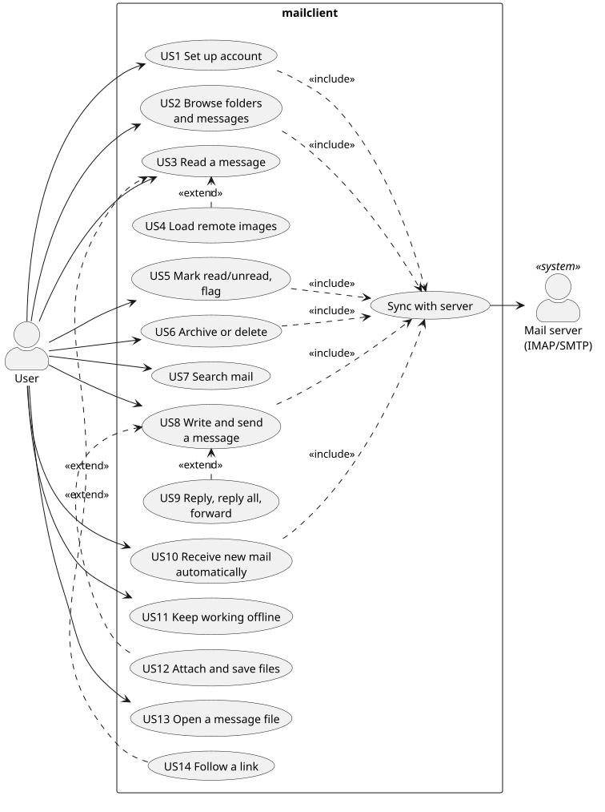

# User stories

Source: [use-cases.puml](use-cases.puml) (render with `java -jar plantuml.jar -tsvg docs/use-cases.puml`).

Each story has acceptance criteria (AC). The desktop suite
`crates/app/src/story_tests.rs` checks the ones marked **auto** against a local
GreenMail server; the rest are checked by hand. Results: [Test results](#test-results).

| ID | Story | Acceptance criteria |
|---|---|---|
| US1 | As a user I set up my account so the app can reach my mail. | Server settings are guessed from the address (**auto**). Login is verified before anything is saved (**auto**). The password goes to the system keyring (Android: Keystore), not to a file. |
| US2 | As a user I browse folders and messages. | Folders appear with the inbox first (**auto**). The inbox lists messages newest first with sender, subject, preview and unread marker (**auto**). On phones one pane is shown at a time. |
| US3 | As a user I read a message. | Opening shows subject, sender, recipients, date and body (**auto**), and marks it read (**auto**). HTML is shown without running scripts (desktop: Servo; Android: system WebView). |
| US4 | As a user I load remote images only when I choose to. | Remote images are blocked and a banner offers loading them; after "Load images" they show (**auto**: e2e `html_mail`, a local server counts the requests). |
| US5 | As a user I mark messages read/unread and flag them. | The change shows immediately (**auto**) and reaches the server (**auto**). |
| US6 | As a user I archive or delete a message. | It leaves the list immediately and the next message is selected (**auto**); on the server it is in Archive or Trash (**auto**). |
| US7 | As a user I search my mail. | Typing filters across folders by subject, sender and downloaded text (**auto**); clearing the search restores the folder. |
| US8 | As a user I write and send a message. | A compose form opens (**auto**); sending delivers it (**auto**) and files a copy in Sent (**auto**); errors keep the draft open with a message. |
| US9 | As a user I reply, reply all or forward. | Recipients, `Re:`/`Fwd:` subject and quoted text are prefilled (**auto**); the original is marked answered (**auto**); forwarding keeps attachments. |
| US10 | As a user I see new mail without refreshing. | Mail arriving while the app is open appears within seconds (**auto**). |
| US11 | As a user I keep working offline. | Flags and moves made offline apply locally and reach the server after reconnecting. |
| US12 | As a user I attach files and save attachments. | File pickers open; attachments are sent and saved correctly. |
| US13 | As a user I open a `.eml` file. | `mailclient file.eml` shows the message without an account (desktop). |
| US14 | As a user I follow links safely. | Clicking a link opens the system browser; `mailto:` opens the composer; nothing navigates inside the message view (desktop). |
| US15 | As a user I read the mail of several accounts in one place. | Further accounts are added from the sidebar; the same address is refused and Cancel returns to the mail (**auto**). "All inboxes" lists every account's inbox newest first, each message with its account's color bar (**auto**). Replies go out through the message's account (**auto**); a folder shows only its account's mail (**auto**). |
| US16 | As a user I read a conversation as a whole. | Replies and the messages they answer share one list row with a message count, also when one side is in Sent (**auto**). The open conversation unfolds in the list as a timeline; the reader shows all its messages oldest first, marks the open one and starts with the newest; any of them can be opened from the timeline (**auto**). Opening reads the whole conversation; archive and delete act on its messages in the listed folder (**auto**). |
| US18 | As a user I keep unfinished messages as drafts. | Leaving the composer (Close; Back on Android) or waiting for the autosave stores the message in Drafts, creating the folder if needed (**auto**). A draft reopens in the composer with its fields (**auto**); saving again leaves a single copy (**auto**). Sending removes it from Drafts (**auto**); Discard deletes it (**auto**); an untouched new message leaves no draft (**auto**). |
| US19 | As a user I am told about new mail. | Unread mail arriving in the inbox while the app runs shows a system notification with sender and subject (**auto**); mail already there when the account is set up does not (**auto**). |
| US20 | As a user I act on several conversations at once. | Rows are ticked at their left edge (phones: long press, then taps) and a bar shows how many (**auto**). Read, flag, unflag, archive and delete apply to all ticked rows and only to them, in the list at once and on the server (**auto**); the ticks clear afterwards or with Clear (**auto**). |
| US21 | As a user I find all mail from the same sender. | "More from this sender" on the open message lists that sender's mail newest first, and mail that only mentions their address is not included (**auto**). `from:address` can be typed, also with more words (**auto**); clearing the search restores the folder (**auto**). Phones show the results in the list. |
| US22 | As a phone user I clear my inbox with a thumb. | Swiping a list row right archives its conversation, swiping left deletes it, like Archive and Delete in the reader; the action shows behind the row while swiping, and a short swipe springs back and does nothing (**e2e**). |
| US23 | As a user I plan meetings with people on other mail systems. | A new event with attendees sends an invitation that shows as an invitation card with the time and Accept / Maybe / Decline (**auto**). Answering mails a REPLY to the organizer, which names the attendee and the answer and shows as a card there too (**auto**); also for Outlook-style organizer names like "Doe, Jane" (**auto**). Accepted and created events appear in the calendar of both accounts (**auto**). The organizer opens the event, sees who was invited, and moves and renames it: the attendee gets an updated invitation (**auto**). Month, week and day views show it at its new time, side by side with overlapping events (**auto**). Deleting asks first and sends the attendee a cancellation (**auto**). |
| US17 | As a user I see my folder tree as it is on the server. | Folders created or removed by another client appear or disappear after a sync (**auto**). Subfolders are indented under their parent, also under Inbox and the special folders, and can be opened (**auto**). |

## Test results

Run of 2026-10-09 against GreenMail 2.1.14. Desktop: `story_tests.rs` on Slint's headless
testing backend (plain-text view, `--no-default-features`), plus window snapshots for the
Servo view. Android: emulator (Pixel 7, Android 15, x86_64), driven with adb taps; server
state checked over IMAP after each step.

| Story | Desktop | Android | Notes |
|---|---|---|---|
| US1 Set up account | pass (auto) | pass | Wrong port shows the error and saves nothing; password in Secret Service / Android Keystore. |
| US2 Browse | pass (auto) | pass | Phones: one pane at a time, Folders button, system Back. |
| US3 Read | pass (auto) | pass | Read flag reaches the server. HTML: Servo on desktop, WebView on Android. |
| US4 Remote images | pass (e2e) | pass (e2e) | 2026-10-10. No request before "Load images", the image after it, never the message's script. |
| US21 Mail from sender | pass (auto, e2e) | pass (e2e) | 2026-10-10. `mail_from_sender`; phones switch to the list. |
| Copy text | pass (e2e) | pass (e2e) | 2026-10-10. `copy_text`: desktop drag + Ctrl+C, Android long press + copy; pasted into the composer. The Android toolbar's Copy button was checked by hand (its window is out of the tools' reach). Desktop double-click does not select a word (Servo 0.7). |
| HTML layouts | pass (e2e) | pass (e2e) | 2026-10-10. `newsletter_templates`: Cerberus, a responsive template and a Postmark receipt render (screenshots `target/e2e/template_*`) with no remote request before "Load images". Android `html_touch`: the WebView scrolls under a finger (header stays), hides under the composer and after Back, and follows the reader into landscape. |
| US23 Calendar invitations | pass (auto) | — | 2026-10-11. Between two GreenMail accounts without a calendar server; CalDAV sync is covered by `mailcore --test caldav` (Radicale). The calendar page is desktop-only for now. |
| US5 Unread / flag | pass (auto) | pass | Both reach the server. |
| US6 Archive / delete | pass (auto) | pass | Land in Archive / Trash on the server. |
| US7 Search | pass (auto) | pass | |
| US8 Write and send | pass (auto) | pass | Copy in Sent; second draft refused while writing; Back keeps the draft (US18). |
| US9 Reply | pass (auto) | pass | Prefilled; original marked answered. Forward not covered by a story test. |
| US10 New mail | pass (auto) | pass | Arrives via IDLE without a manual sync. Android, 2026-10-10 by hand: with the app 60 s in the background (process not frozen thanks to the service), new mail shows a notification within seconds. |
| US11 Offline | partial (auto) | partial | Covered: the server dropping an idle connection. Not covered: working with no network, then reconnecting. |
| US12 Attachments | not tested | pass | 2026-10-10, by hand on the emulator: two files attached through the system picker, sent, received with both; one saved to Downloads through "Save as" with the same bytes; cancelling the picker changes nothing. Pickers are not automated. |
| US13 Open .eml | pass (manual) | n/a | |
| US14 Follow links | not tested | pass (e2e) | Android: `html_touch` taps a `mailto:` link in the WebView and gets a prefilled composer. Desktop needs a real click in the Servo view. |
| US15 Multiple accounts | pass (auto) | not tested | Two GreenMail accounts. |
| US16 Conversations | pass (auto) | not tested | Conversation between the two GreenMail accounts. |
| US17 Folder tree | pass (auto) | not tested | Nested folders created and deleted over IMAP during the run. |
| US20 Bulk actions | pass (auto, e2e) | pass (e2e) | 2026-10-10. Android ticks with a real long press (`adb input swipe`). |
| US19 Notifications | pass (auto, e2e) | pass (e2e) | 2026-10-10. Desktop e2e reads the D-Bus `Notify` call, Android e2e `dumpsys notification`. |
| US22 Swipe rows | n/a | pass (e2e) | 2026-10-10. `swipe_rows`: real finger swipes through `adb input swipe`; Archive and Trash checked on the server. |
| US18 Drafts | pass (auto) | pass (e2e) | 2026-10-10. Android: `crates/e2e` `drafts`, leaving with the system Back key. |

Bugs found by this run and fixed:

- A connection the server had dropped returned empty results instead of an error, and
  sync took that as "all messages deleted", emptying the local cache (async-imap 0.12
  ends response streams silently on EOF). Every IMAP read is now confirmed with a NOOP,
  and the engine reconnects and retries once.
- Setup guessed the name from the first typed character and never updated it.
- Android: a second window (compose) cannot be shown, so composing moved into the main
  window on both platforms; system Back closed the app from any screen; compose fields
  sat under the status bar; symbols (☰ ⟳ ✎ ↩ ☆) are missing from Android's fonts.
